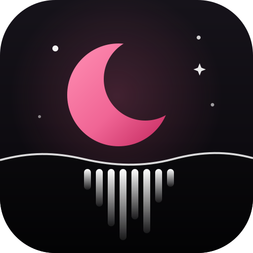

<p align="center"></p>

<h1 align="center">Moonwave</h1>

<p align="center">A music player that lets you download your favorite songs from YouTube.</p>

<p align="center">
  
  <a href="LICENSE"></a>
  
  
  
  
  
</p>

This is my personal music player. It plays my music folders, keeps my own lists, and lets me download my favorite songs from YouTube using [yt-dlp](https://github.com/yt-dlp/yt-dlp) and [ffmpeg](https://ffmpeg.org), straight into my library.

## Build

Linux only for now. You need Node.js, Rust, and GStreamer's `gst-plugins-good` and `gst-libav` (for MP3 and M4A).

```sh
npm install
./scripts/fetch-tools.sh   # yt-dlp and ffmpeg, checked against their checksums
npm run dev                # or: npm run app
```

## Note

Downloads are for your own listening. Only download what you have the right to keep.

## License

[MIT](LICENSE) © 2026 Adam Elmi
