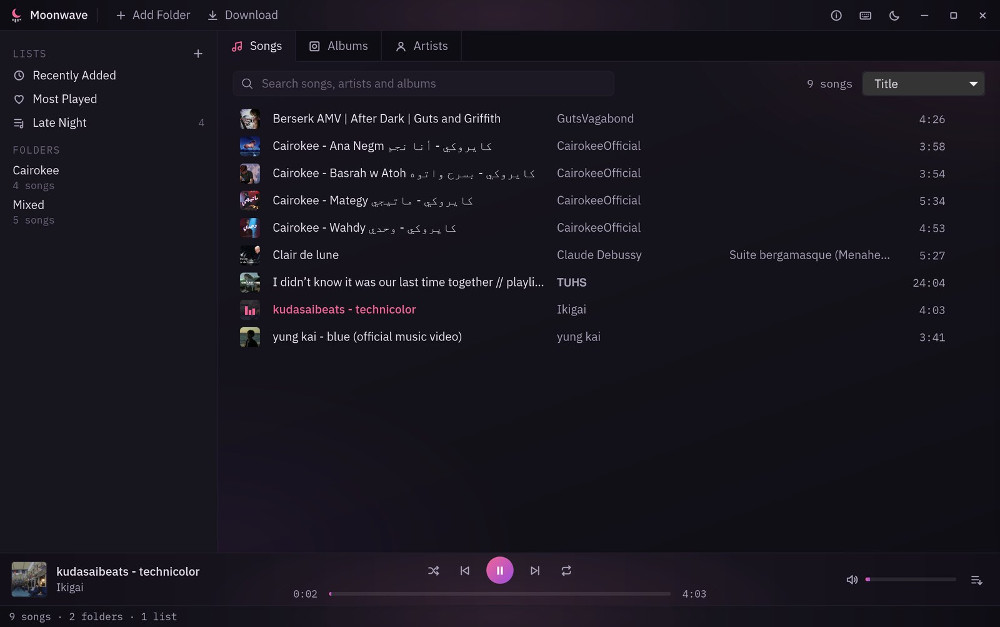
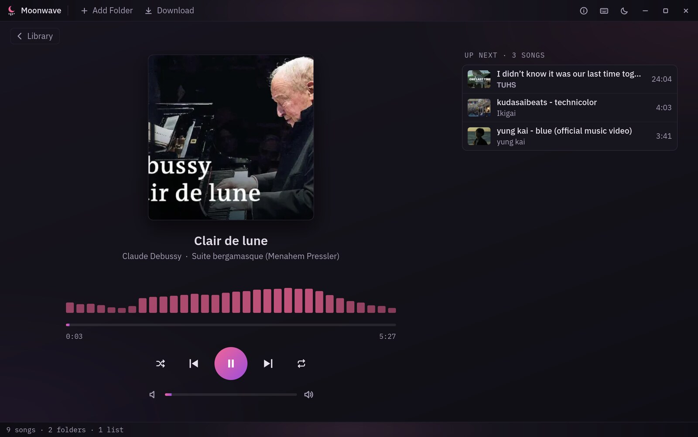
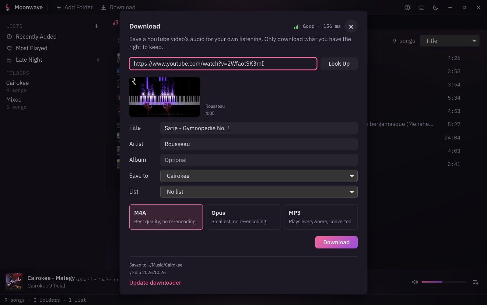
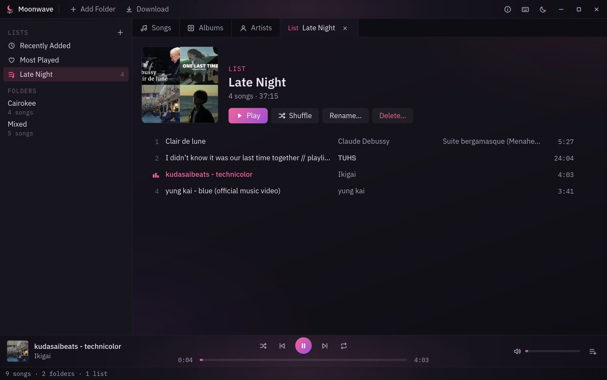
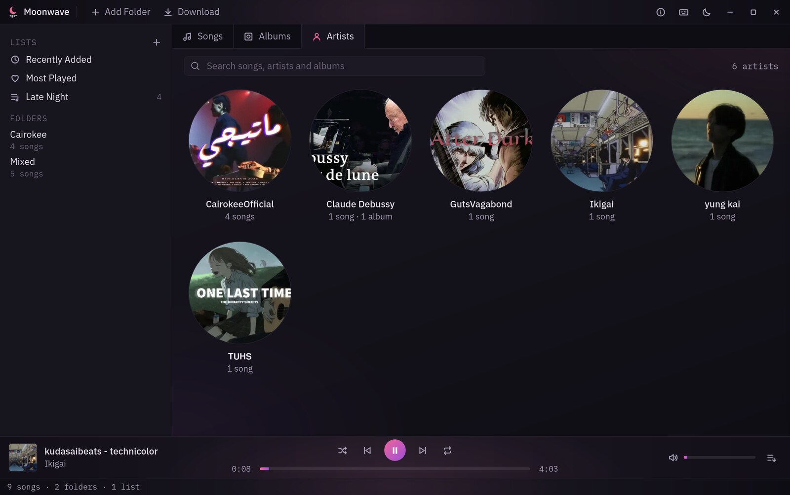
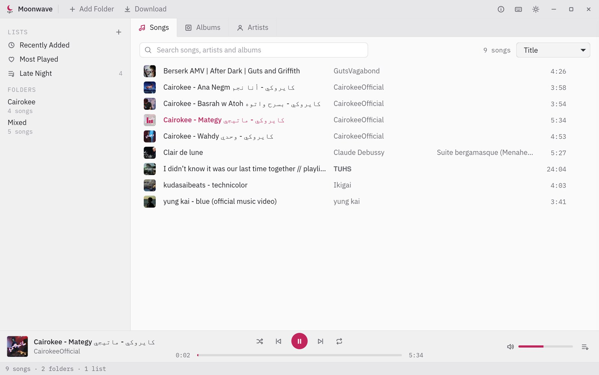

<p align="center"></p>

<h1 align="center">Moonwave</h1>

<p align="center">A music player that lets you download your favorite songs from YouTube.</p>

<p align="center">
  <a href="https://github.com/Adam-Elmi/Moonwave/releases/latest"></a>
  <a href="LICENSE"></a>
  <a href="https://github.com/Adam-Elmi/Moonwave/releases/latest"></a>
  <a href="https://github.com/tauri-apps/tauri"></a>
  <a href="https://github.com/rust-lang/rust"></a>
  <a href="https://github.com/Adam-Elmi/ArcMoon"></a>
  <a href="https://github.com/yt-dlp/yt-dlp"></a>
</p>

This is my personal music player. It plays my music folders, keeps my own lists, and lets me download my favorite songs from YouTube using [yt-dlp](https://github.com/yt-dlp/yt-dlp) and [ffmpeg](https://ffmpeg.org), straight into my library.

<p align="center"></p>

<table>
  <tr>
    <td></td>
    <td></td>
  </tr>
  <tr>
    <td align="center">Now Playing</td>
    <td align="center">Download</td>
  </tr>
  <tr>
    <td></td>
    <td></td>
  </tr>
  <tr>
    <td align="center">Your lists</td>
    <td align="center">Artists</td>
  </tr>
  <tr>
    <td colspan="2"></td>
  </tr>
  <tr>
    <td colspan="2" align="center">Light theme</td>
  </tr>
</table>

## Install

Get it from [Releases](https://github.com/Adam-Elmi/Moonwave/releases):

- **Windows:** the setup `.exe` or the `.msi`. Windows may warn that the app is from an unknown publisher (it isn't signed): choose **More info → Run anyway**.
- **Linux:** the AppImage, `.deb` or `.rpm`. For MP3 and M4A install GStreamer's `gst-plugins-good` and `gst-libav`; downloads need Node.js.

## Build

Linux or Windows. You need Node.js and Rust; on Linux also GStreamer's `gst-plugins-good` and `gst-libav`, on Windows Git Bash (it comes with Git) to run the script.

```sh
npm install
./scripts/fetch-tools.sh   # yt-dlp and ffmpeg (and deno on Windows), checked against their checksums
npm run dev                # or: npm run app
```

## Note

The downloader is for your own personal listening. Only download songs you're allowed to: music you own, or music its owner lets people download (for example, free or Creative Commons songs). Downloading other people's music without permission can break copyright law and YouTube's terms.

## License

[MIT](LICENSE) © 2026 Adam Elmi
